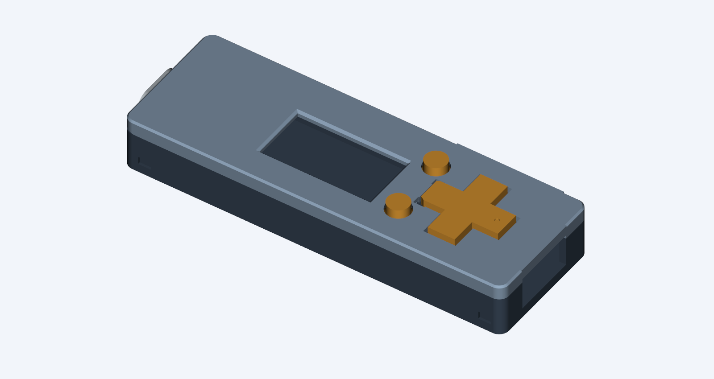

> **WITHDRAWN: do not print. The fixed D-pad socket has no rigid assembly path. Revision J replaces it with an underside-loaded flange.**

# Prototype I — retained D-pad and enclosed SD

Revision I implements the October 21 feedback on the printed F case. It keeps
Select and Back unchanged, replaces the loose D-pad with a spherical guide,
closes the SD opening, and reduces the shell dimensions.

| Dimension | F | I |
|---|---:|---:|
| Body length | 77.3 mm | 77.3 mm |
| Body width | 27.6 mm | 26.2 mm |
| Body height | 12.1 mm | 10.85 mm |
| Height including round buttons | 13.15 mm | 12.45 mm |
| USB-A aperture height | 8.3 mm | 6.7 mm |

Print **base, lid and D-pad** together. Reuse the F **Select, Back and USB-C
collar**. Matching optional TPU end covers are included.

- [Print pack](fuse-vault-case-i-print-pack.zip)
- [Print and assembly instructions](PRINT-AND-ASSEMBLY.txt)
- [Editable assembly](case-assembly.step)
- [Clearance and mesh checks](validation.json)
- [Closure checks](closure-validation.json)
- [SD wall, reuse and cover checks](detail-validation.json)



The spherical guide uses a nominal 0.2 mm surface clearance. CAD verifies
clearance through the sampled ±5° tilt and interference against excessive
lift/translation. It does not establish printed feel or wear. The unchanged
buttons protrude 0.55 mm farther above the lowered lid.

**Dry-fit the display flex before closing:** the base now reserves 2.4 mm below
the PCB, reduced from the earlier provisional 3.0 mm fold allowance. The
exported electronics fit, but the actual folded cable has not been measured.
The SD card is installed before the board goes into the enclosure.

F is preserved. G/H remain archived experiments; I starts from F.

Regenerate with CadQuery 2.8, trimesh and VTK:

```sh
python CaseDesign/build_case_i.py
python CaseDesign/check_case_f_closure.py CaseDesign/prototype-i
python CaseDesign/check_case_i_details.py
python CaseDesign/render_case_f.py CaseDesign/prototype-i
python CaseDesign/package_case_i.py
```

The builder depends on the local F STEP parts; see the root case README for
regenerating those from a fresh checkout. This revision has passed CAD checks;
physical fit, switch return, print tolerances and snap durability remain untested.
