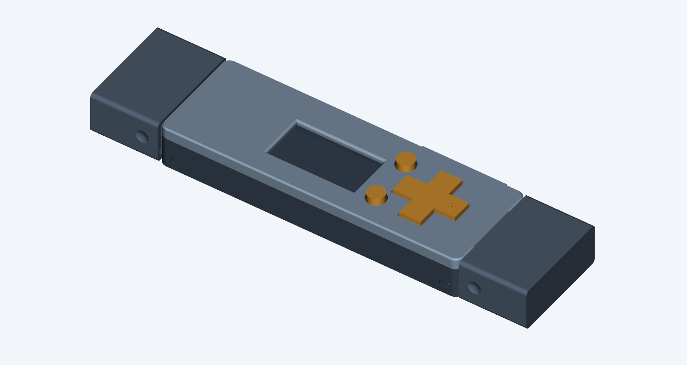

> **Superseded by revision K after physical feedback:** J lacked installed-card clearance, left the round buttons too proud, and its cap tongues were unsuitable for the user’s PLA prints. Use K for the next fit trial.

# Prototype J — simpler D-pad and interchangeable flush caps

J replaces the unassemblable I bearing with a one-piece D-pad that loads from
underneath the lid. A closer cross opening controls sideways play; four solid
roof corners above its flange limit lift. Contact posts sit 0.10 mm nearer the
switches than F, leaving approximately 0.088 mm clearance to the library model.
The working Select and Back buttons and USB-C collar are unchanged.
The D-pad has hidden clearance relief beside their guides, blended out below
the thumb face; the lid opening follows the cross without stray corner notches.

Two **identical TPU caps** fit either end. They share the case's outer width and
height, attach using concealed side tongues and have recessed finger grips.
No A/C labels are needed: both caps are identical.
Equal cap lengths accommodate the longer connector at both ends.



- [Print pack](fuse-vault-case-j-print-pack.zip)
- [Print and assembly instructions](PRINT-AND-ASSEMBLY.txt)
- [D-pad section and assembly path](dpad-cutaway.png)
- [Editable assembly](case-assembly.step)
- [Geometry and electronics checks](validation.json)
- [Cap and insertion checks](detail-validation.json)
- [Closure checks](closure-validation.json)

Print the new base, lid, D-pad and **two copies of universal_end_cap.stl**.
Reuse the two F buttons and collar. Use 100% scale; none of the controls are
scaled versions of the old parts. The round buttons protrude 0.55 mm farther
above the lowered roof, retaining their original seating and guide geometry.

| Dimension | F | J |
|---|---:|---:|
| Body length | 77.3 mm | 77.3 mm |
| Body width | 27.6 mm | 26.2 mm |
| Body height | 12.1 mm | 10.85 mm |
| Height with round buttons | 13.15 mm | 12.45 mm |
| USB-A aperture height | 8.3 mm | 6.7 mm |
| D-pad opening clearance, per side | 0.75 mm | 0.35 mm |

CAD blocks a 0.4 mm upward D-pad shift and permits sampled +/-3 degree rocking.
This is not zero play: the opposite arm rises when a direction is pressed.
The caps add 17.55 mm at each end; capped overall length is 112.4 mm.

**Physical fit is untested.** Dry-fit the display flex before closing: the
floor allowance is now 2.4 mm below the PCB, and the actual fold is unmeasured.
Check that no switch remains pressed at rest. TPU retention force and wear
require a printed trial. SD access is internal; install the card before closing.

F remains the physical baseline. I is withdrawn because the fixed bearing had
no assembly path; J explicitly checks underside insertion of all controls.

Regenerate using the CAD environment and F source exports:

```sh
python CaseDesign/build_case_j.py
python CaseDesign/check_case_f_closure.py CaseDesign/prototype-j
python CaseDesign/check_case_j_details.py
python CaseDesign/render_case_j.py
python CaseDesign/render_case_j_cutaway.py
python CaseDesign/package_case_j.py
```
