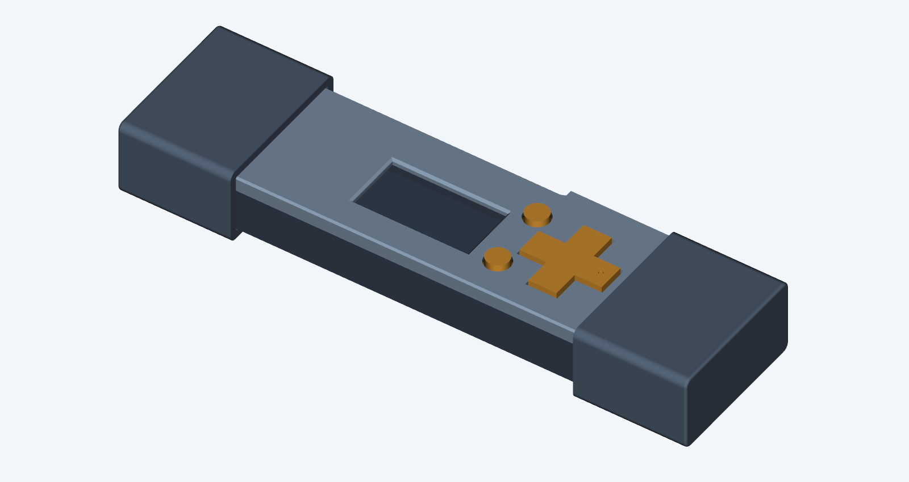

# Prototype K — PLA sleeves, restored SD space and broader D-pad pads

K addresses the physical feedback on J. All printed parts are **PLA**.

- D-pad contact pads enlarged from 1.7 to **3.2 mm diameter**, retaining their
  current contact height and simple captive flange.
- SD shoulder and installed-card allowance restored, with a continuous closed
  wall around them. The floor returns to Z=-2.9.
- Select and Back tops shortened **0.55 mm**, restoring F's **1.05 mm** protrusion.
  Stems, retaining flanges and seated positions are preserved.
- Caps return to full sleeves with **1.6 mm walls**. One identical cap fits either
  end and either 180-degree roll orientation. Small retaining bumps sit on the
  centre line, with matching case dimples. No tongues or A/C labels.



[Print pack](fuse-vault-case-k-print-pack.zip) ·
[Print and assembly instructions](PRINT-AND-ASSEMBLY.txt) ·
[Underside of the controls](contacts.png) ·
[Editable assembly](case-assembly.step)

Print base, lid, D-pad, Select, Back and **two copies of universal_end_cap.stl**.
Reuse only the USB-C collar. Do not use the old tall round buttons with this lid.

The main body is 77.3 × 26.2 × 11.35 mm, widening to 27.6 mm at the SD shoulder.
The restored floor depth adds 0.5 mm compared with J. Both caps fitted give
110.8 × 29.8 × 14.95 mm overall; these overlap the body like the earlier sleeves.
Equal cap lengths accommodate the longer connector at both ends.

**Physical fit is untested.** The explicit card reserve restores the earlier
allowance rather than relying on the socket-only PCB model. Verify actual
installed-card and folded-display-cable clearance before closing. The small
PLA cap interference is nominally 0.10 mm per side and still needs a print trial.
Larger D-pad pads do not change the switches' inherent tactile characteristics.

[Geometry/electronics checks](validation.json),
[card, controls and cap checks](detail-validation.json), and
[closure checks](closure-validation.json) document the checks and their limits.

Regenerate with CadQuery 2.8, trimesh, VTK and matplotlib, using F's STEP sources:

```sh
python CaseDesign/build_case_k.py
python CaseDesign/check_case_f_closure.py CaseDesign/prototype-k
python CaseDesign/check_case_k_details.py
python CaseDesign/render_case_k.py
python CaseDesign/render_case_k_cutaway.py
python CaseDesign/package_case_k.py
```
