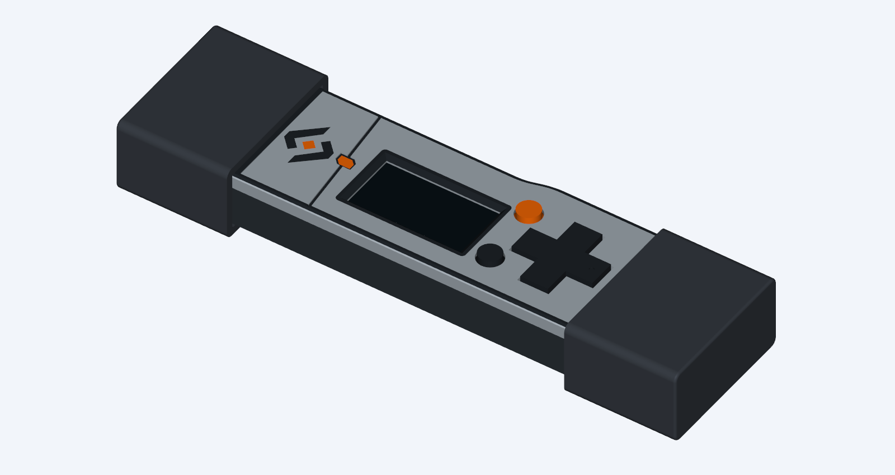
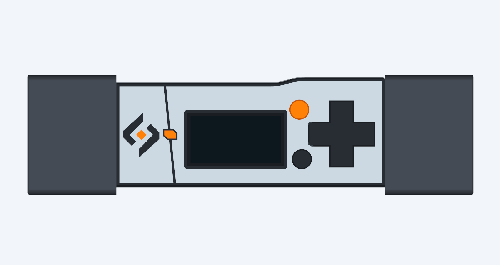

# Fuse Vault L — panelled v2

Revised 31 October 2026 after the first cosmetic CAD version missed the intended
panel treatment and left an abrupt edge at the SD-card shoulder.




## What changed

- A tangent exterior curve blends the left approach to the SD shoulder from
  X=41 to 49.8 mm. Material is added outside the existing wall; the card cavity
  and existing wall remain intact. The curve continues across base and lid.
- The cap-side end of the shoulder is retained where it meets the USB-A cap,
  preserving its seat. The original cap covers that transition when fitted.
- A single, slightly slanted 0.6 mm panel joint replaces the earlier zigzag.
  A compact recessed orange inset sits within a local keyed opening.
- A fine dark perimeter follows the curved shoulder. A dark screen surround
  colours the existing bevel without changing the aperture or glass reserve.
- The actual Vault logo polygons remain at 80% scale, with an orange centre.

## Printing and reuse

Print the **new base and multipart lid together** for the matching outer curve.
Reuse L's D-pad, Select, Back, screen shim, USB-C collar and both caps. They are
geometrically unchanged; included files allow a complete second assembly.
The display is still mounted to the PCB/shim; preserve the existing adhesive
stack and flex routing when transferring the working board.

- [Print pack](fuse-vault-l-panelled-v2-print-pack.zip)
- [Editable coloured CAD assembly](case-assembly.step)
- [Registered multipart lid](lid-ams.3mf)
- [Print and assembly notes](PRINT-AND-ASSEMBLY.txt)
- [Independent geometry checks](detail-validation.json)

The three colour files form **one multipart printed lid**, not loose inserts.
`lid.stl` alone has empty colour pockets. `lid_single_colour.stl` is the full
one-colour alternative; the flush logo and colour frame disappear in this option,
while the recessed panel joint remains.

## Validation and limitations

The builder's checks and 736 independent exported-geometry checks passed.
Evidence covers unchanged accessories and snaps, card/PCB loading reserves,
joined-lid closure, controls movement, added material against source electronics,
watertight meshes and print registration. The 3MF is read back after packaging
to verify the three meshes and their placement.

The images are actual CAD renders. Printing, surface finish, colour adhesion and
retention force still require a physical trial. L remains the confirmed assembly
baseline; this is a separate cosmetic revision, not a replacement for those files.

## Rebuild

Requires CadQuery 2.8.0, trimesh, VTK and the local L STEP/STL inputs. See the main
CaseDesign README for rebuilding those inputs if absent from a fresh checkout.

```sh
python CaseDesign/build_case_l_panelled_v2.py
python CaseDesign/check_case_l_panelled_v2.py
python CaseDesign/render_case_l_styles.py panelled-v2
python CaseDesign/package_case_l_styles.py panelled-v2
```

The builder imports export helpers from `build_case_l_styles.py`. Source files
and baseline hashes are included in the manifest. The earlier precision and
panelled versions are preserved.
