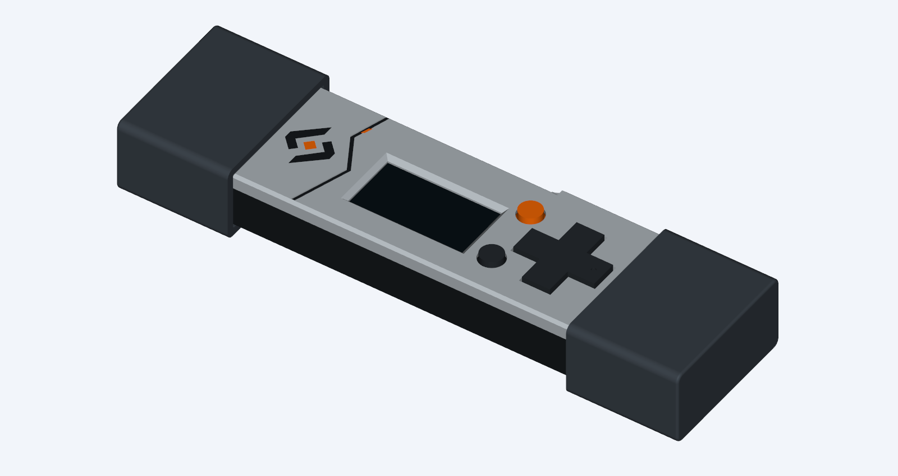

# Fuse Vault L — Panelled technical

Cosmetic CAD variant of the working revision L, created 31 October 2026.
Light-grey lid, charcoal body and controls, orange Select and logo centre. One stepped diagonal seam with a small orange accent divides the logo area from the screen area. L caps are unchanged.

The emblem uses the exact two arm polygons and diamond from the earlier G brand
reconstruction, not the approximated emblem in the AI mockups. L remains the
physical fit baseline. This cosmetic variant requires a print trial.



## Files

- `case-assembly.step`: assembled, named and coloured editable CAD.
- `lid-ams.3mf`: registered three-colour lid model, without printer settings.
- `lid-ams.step`: same multipart lid in print orientation.
- `lid.stl`, `lid_inlay_dark.stl`, `lid_inlay_orange.stl`: colour bodies, import
  together as ONE multipart object. These are not separate glue-in inserts.
- `lid_single_colour.stl`: complete one-colour lid alternative. The logo is flush
  and therefore disappears in this alternative; the panel seam remains if present.
- `universal_end_cap.stl`: print twice if replacing the caps.
- `top.png`, `exploded.png`: actual exported CAD views.
- `validation.json`, `detail-validation.json`: geometry and mesh evidence.
- `PRINT-AND-ASSEMBLY.txt`: print and reuse instructions.

## Rebuild

Requires the local L STEP/STL inputs and CadQuery 2.8.0, trimesh and VTK.
If those ignored STEP files are absent, regenerate L and its dependencies using
`CaseDesign/README.md`. From the repository root:

```sh
python CaseDesign/build_case_l_styles.py
python CaseDesign/check_case_l_styles.py
python CaseDesign/render_case_l_styles.py
python CaseDesign/package_case_l_styles.py
```

The scripts build both styles. They do not modify the L source files. Source
hashes are recorded. CAD checks establish geometric preservation, not physical
retention force, fatigue, material adhesion or slicer behaviour.
