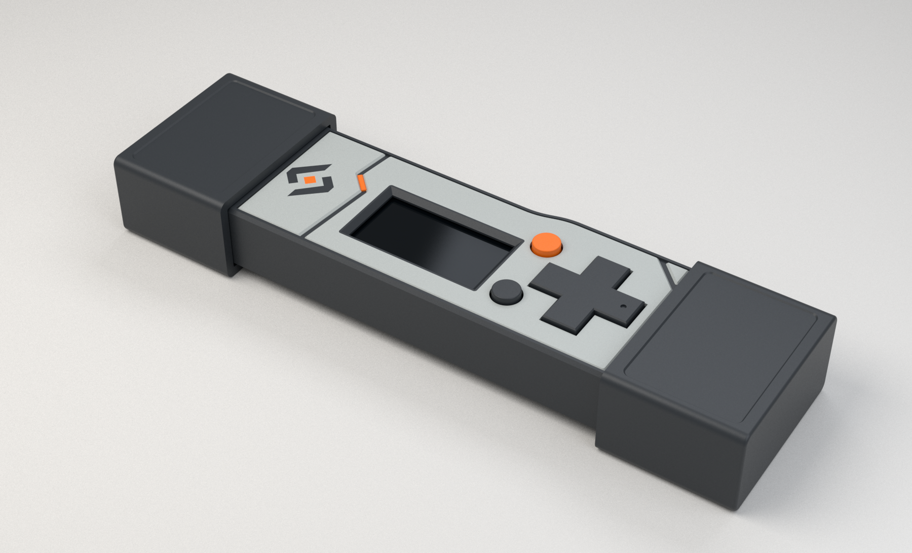
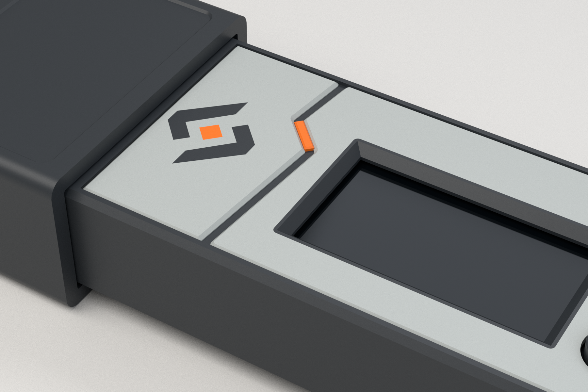

# Fuse Vault L — sculpted panel study

This revision develops the exterior surfaces after the earlier flat cosmetic
versions failed to capture the concept's depth. It retains L's working internal
fit and the smooth SD-shoulder transition developed in panelled v2.





## Exterior design

The face has two broad grey panels and a smaller corner facet. Each is a real
shaped volume with a 0.30 mm bevel; the channels between them sit 0.40 mm below
the faces. A narrow orange tongue follows the diagonal part of the keyed joint.
The original Vault emblem is printed flush into the logo panel. A narrow dark
lip follows the existing screen aperture, without changing the glass reserve.

The face tops and outer rail remain at L's Z=7.25 mm. They therefore contact the
build plate together when printed face down. The grey material extends to Z=6.65,
leaving at least 0.60 mm of the original roof below the ordinary panel pockets.
Above the existing snap pockets, the dark carrier is locally 0.45 mm thick;
the overlying grey material completes the original roof thickness there. The
completed multi-colour union remains a single continuous enclosure.

The exposed D-pad and round-button top rims are eased by 0.20 mm while their
contacts, stems, flanges and guide geometry remain unchanged. Original L controls
are still compatible.

Both broad faces of each cap have a shallow 0.24 mm recessed field with eased
edges. The cavity, detents and sidewalls are retained. Caps remain identical at
either end and reversible. Original L caps are also compatible.

## Deliverables

- `studio.png`, `detail-studio.png`, `top-studio.png`: final CAD studio renders.
- `case-assembly.step`: named and coloured editable assembly.
- `lid-ams.3mf`: three registered print-colour groups, no printer settings.
- `lid-ams.step`: same three groups in face-down print orientation.
- `lid_ams_charcoal.stl`, `lid_ams_grey.stl`, `lid_ams_orange.stl`: import these
  together as ONE multipart object if not using the 3MF.
- Individual `lid_panel_*`, `lid_inlay_*` and `lid` files: editable CAD regions,
  not additional parts to print on top of the three groups.
- `lid_single_colour.stl`: complete geometric lid for a one-colour trial. Its
  bevels and relief remain; the flush logo and colour distinctions disappear.
- `base.stl`: matching smooth-shoulder base.
- `universal_end_cap.stl`: new sculpted cap; print twice if using this treatment.
- `surface-section.png`: dimensioned section through the actual CAD joint.
- `PRINT-AND-ASSEMBLY.txt`: print choices and reuse instructions.
- `validation.json`, `detail-validation.json`, `source-manifest.json`: evidence.

The colour regions form one multi-material printed lid. They are not loose
panels intended for assembly with glue or screws. Only three filament colours
are required despite the separate editable CAD regions.

## Rebuild

Requires the read-only L STEP/STL inputs, CadQuery 2.8.0, trimesh and VTK. See
`CaseDesign/README.md` for rebuilding the ignored L STEP inputs when necessary.

```sh
python CaseDesign/build_case_l_sculpted.py
python CaseDesign/check_case_l_sculpted.py
python CaseDesign/render_case_l_styles.py sculpted
python CaseDesign/render_case_l_sculpted.py --spp 512 --width 1800
python CaseDesign/render_case_l_sculpted_section.py
python CaseDesign/package_case_l_styles.py sculpted
```

The dedicated studio renderer uses Mitsuba 3.9.1 and Dr.Jit 1.5.0 in addition
to the CAD runtime. Its source and `render-settings.json` document the settings. All renders show exported CAD, not an image-generated redesign.

The final independent checker passed 795 checks with zero failures and binds
its evidence to 40 STEP/STL/validation files by SHA-256.

Physical finish, multi-colour bonding, bridging and retention feel still require
a print trial. The confirmed L baseline and previous style variants are retained.
