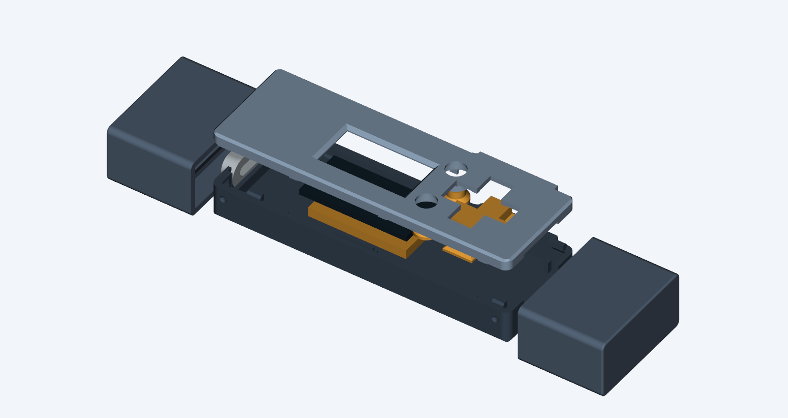

# Prototype L — aligned D-pad, raised screen and eased pocket edges

A full-case print trial based on K and the user's 22 October feedback: all prior
cases assembled, K improved the result, but the direction toward the screen felt
mushy; the glued-down screen sat too deep and the shell needed its edges softened.

- Contact noses follow the source switch actuator surfaces, approximately 0.35 mm
  from the placement origins used previously. Noses are 2.2 mm with tapered shoulders.
- Relieved retaining corners give the rocker clearance through the checked ±4° range.
- A 2.4 mm platform raises the screen; the lid has a matching reserve and flared window.
- The shell has eased outer edges and SD shoulder corners.
- Four ramped snaps increase from 0.25 to 0.35 mm engagement, with matching pockets.
- Cap bumps grow to 0.85 mm radius with 1.0 mm-radius pockets: 0.40 mm nominal
  sleeve-wall flex per side, up from K's 0.10 mm. Pocket depth increases from
  0.25 to 0.55 mm. Both caps remain identical.
- K round buttons and USB-C collar are preserved.

**Physical assembly confirmed, 22 October 2026.** The user reports that L is
"pretty good" and "all goes together well". Keep L as the current assembly baseline.
The remaining button feel may be limited by switch quality; this is the user's
assessment, not a confirmed diagnosis. No further geometry change is indicated
by this feedback. Cap retention force, long-term wear and electrical actuation
reliability have not been separately quantified.

[Print pack](fuse-vault-case-l-print-pack.zip) ·
[Print and assembly instructions](PRINT-AND-ASSEMBLY.txt) ·
[Editable assembly](case-assembly.step) ·
[Geometry checks](validation.json) · [Independent detail checks](detail-validation.json)



Print the L base, lid, D-pad, screen shim, Select, Back and two universal caps.
Reuse the USB-C collar. Identifiable K round buttons can also be reused. Print the new L caps for stronger retention.
The default print trial assumes ordinary PLA on the P1S with a 0.4 mm nozzle.

The shim supports the module at Z=4.0, with nominal display face Z=5.5 before
adhesive. A 1.6 mm module and 0.2 mm total adhesive give Z=5.8, below the Z=5.95
lid reserve. The bezel remains above the glass. Dry-fit before bonding and keep
the display flex free; the screen must never act as a shell-clamping spacer.

Regenerate in the existing CadQuery 2.8 environment, after building K's STEP inputs:

```sh
python CaseDesign/build_case_l.py
python CaseDesign/check_case_l_details.py
python CaseDesign/render_case_l.py
python CaseDesign/package_case_l.py
```

The builder records K input hashes and checks that those sources remain unchanged.
The independent checker derives actuator centres from the source PCB geometry,
checks lower switch-housing clearance during rocking, raised-display clearance
through lid closure, cap removal and preservation of unchanged accessories.
