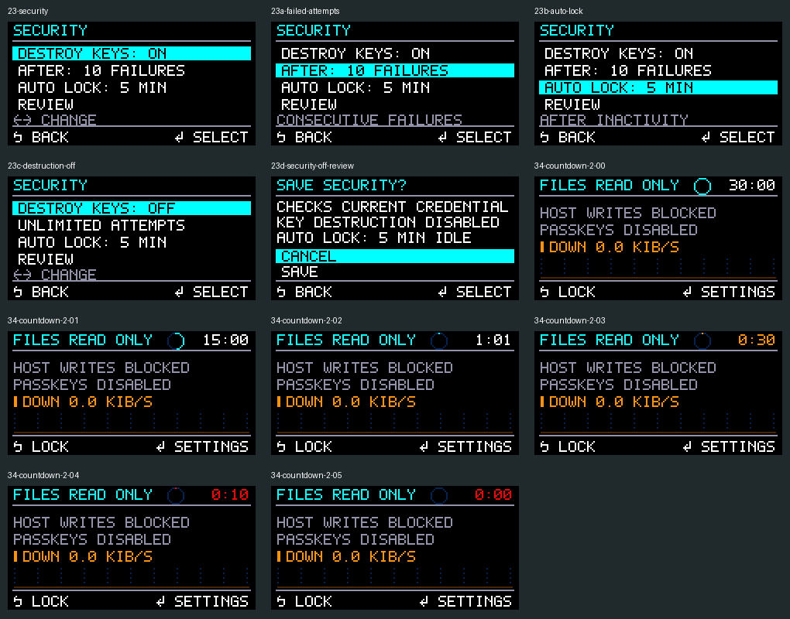

# Security settings — 1 November 2026

Implemented on active `src/`, based on commit
`9b4037d49526255ddcee3a3b9e9c6c22d0112ba5` plus local workspace changes.
No board was flashed, provisioned or erased.

## Behaviour

Settings → Security combines failed-attempt key destruction and automatic lock.
Saving requires Full access, the current credential, and explicit Review → Save.
Files, passkeys and the VMK are preserved; saving ends the session.

| Setting | Choices | New-vault default | Existing vault |
| --- | --- | --- | --- |
| Destroy keys | Enabled after 1–100 consecutive failures, or disabled | Enabled, 10 failures | Saved policy retained |
| Auto lock | Off, 1, 2, 5, 10, 15, 30 minutes idle | 5 minutes | Off until changed |

The dashboard's countdown ring and M:SS display fit all three session modes and
both screen orientations. It turns amber at 30 seconds and red at 10 seconds.
The previews below use the real renderer, not design mockups.



The timer starts after authentication and continues in settings and FIDO prompts.
Physical button activity, completed nonempty file I/O, successful FIDO credential
creation/sign-in and successful reverification renew it. Status/sync polling and
FIDO discovery/retry/key-agreement queries do not. Sustained host I/O can keep an
inactivity timer alive.

Expiry revokes the shared session generation, wipes vault keys, cancels FIDO,
suppresses stale completions/fragments and returns the UI to locked. A quiet
worker polls without waiting for requests. Checks also run during prompt waits
and at operation boundaries. An in-progress durable storage batch may complete
before expiry is applied; completed plaintext reads are cleared if the worker
detects expiry before publication. Data already sent to a host cannot be revoked.

## Policy compatibility

Disabled destruction uses action `FV_LIMIT_NONE` (5), with canonical zero attempts
and no pending guess. Unlimited authentication performs no attempt-accounting
journal writes, avoiding counter exhaustion and journal wear from repeated
guesses. Wrong credentials still fail; wrong FIDO reverification still locks.
The byte-sized FIDO UV-retry report remains at 255 while unlimited.

The authenticated 16-byte policy uses previously reserved bytes 10–13 for the
little-endian timer duration. Old zero values mean Off. Policy/header matching
and approved changes include the timer. The journal, SD layout, OTP allocation,
credential encoding and data-key derivation are unchanged.

Old firmware rejects the newly used policy bytes/action. Keep this firmware or
a compatible newer version after saving either new option. Saving destruction
enabled and auto-lock Off again does not make downgrade safe: older firmware
validates every committed journal record, including history that can still
contain an unsupported policy. Existing legacy permanent-lockout records remain
enforced; the new UI only offers destruction enabled or disabled. No migration
of older incompatible development formats is introduced.

New enrollment also writes an initial EMPTY record with the new default timer,
so the same downgrade restriction applies even if final setup selects timer Off.

## Local validation

All 47 distinct host/FIDO tests passed under AddressSanitizer and
UndefinedBehaviorSanitizer: 46/46 in the broad regression run, plus the final
FIDO adapter test run separately after its added timeout scenarios. The
exhaustive FIDO journal interruption test passed in 892.21 seconds; the large
journal reference test passed in 350.73 seconds. Completed checks include:

- ASan/UBSan tests for portable deadlines, exact expiry, rounding, disabled
  timers, generation-scoped local events, stale events, callback cleanup and
  activity that cannot revive an expired session.
- Vault and actual OTP-journal tests: 256 wrong unlimited guesses with recovery,
  no attempt writes, subsequent valid unlock, disabling/re-enabling destruction,
  timer persistence, legacy bytes, corruption rejection and unchanged VMK/data.
- Actual FIDO adapter with the real timeout controller: successful-operation
  renewal, discovery/rejection without renewal, expiry during credential and
  presence prompts, expiry after an answer before verification, completed
  response invalidation and interrupted HID fragments.
- UI key-flow and framebuffer tests, plus visual inspection of real previews.
- Generated TinyUSB MSC driver tests at 4,096, 16,384, 32,768 and 65,024-byte
  buffer sizes, including write protection, command boundaries and stale output.
- Full Release board firmware with UI/TFT/MSC/FIDO and all debug switches Off.
- `git diff --check` passed. The fresh release build's generated USB driver
  sources match the tested sources byte for byte.

Saved test output: [host regression](security-settings-20261101/host-tests.txt),
[final FIDO adapter](security-settings-20261101/fido-adapter.txt),
[USB driver buffer matrix](security-settings-20261101/usb-driver.txt).

Leak checking is disabled (`ASAN_OPTIONS=detect_leaks=0`); sanitizer results do
not claim leak validation. No physical timing, host filesystem cache or power-cut
testing was performed here.

## Firmware image

The fresh Release build uses the repository's existing `fuse_vault` RP2354 pin
configuration, SDK 2.3.0, TFT/UI, MSC and FIDO, 32 KiB USB buffers, with all debug
switches disabled. Picotool confirms RP2350 ARM Secure, 1 November 2026 build,
and image bounds `0x10000000–0x1007dd18`, below the authority journal at
`0x101fe000`. Production secure boot and OTP access locks remain unchanged.

ELF section totals: text 521,492 bytes, data 0, BSS 368,128 bytes. Compared with
the previous unlock-mode image, this adds 3,656 bytes of text and 56 bytes of
static RAM. These are linker sizes, not a peak stack/heap measurement.

UF2 SHA-256:

```text
6ddeda438d628062937476eca3944ea8d1fa915962cd56d6d540cf60aae9b476
```

## Reproduction

```sh
cmake -S . -B build-unlock-modes-host \
  -DFV_MBEDTLS_DIR=/home/adam/pico-sdk/lib/mbedtls \
  -DFV_ENABLE_FIDO_ENGINE=ON -DCMAKE_BUILD_TYPE=Debug -DFV_SANITIZERS=ON
cmake --build build-unlock-modes-host -j8
ASAN_OPTIONS=detect_leaks=0 ctest --test-dir build-unlock-modes-host --output-on-failure -j4
cmake -S src/pico/device -B build-security-settings-board \
  -DPICO_SDK_PATH=/home/adam/pico-sdk -DPICO_NO_PICOTOOL=1 \
  -DFV_DEVICE_UI=ON -DFV_USB_MSC=ON -DFV_USB_FIDO=ON \
  -DFV_TFT_DISPLAY=ON -DCMAKE_BUILD_TYPE=Release
cmake --build build-security-settings-board -j8
ASAN_OPTIONS=detect_leaks=0 python3 src/host/tools/test_usb_pipeline_driver.py \
  --sdk /home/adam/pico-sdk --firmware-build build-security-settings-board --sanitize
v1/firmware/build/_deps/picotool/picotool uf2 convert \
  build-security-settings-board/fuse_vault_security.elf \
  dist/firmware-20261101-security-settings/fuse-vault-security-settings.uf2 \
  --family rp2350-arm-s --platform rp2350
```

## v3 board checks

1. Flash using the existing BOOTSEL procedure. Unlock the existing vault and
   confirm its saved attempt policy and auto-lock Off; do not choose erase/setup.
2. In Full access, set auto-lock to one minute, Review → Save, then unlock. Check
   the ring/time in Full, Passkeys only and Read-only modes, including flipped
   orientation. Leave idle and confirm files and passkeys both become unavailable.
3. Repeat while in Settings and while a passkey prompt waits. Verify a fresh
   credential is required after expiry. Test with storage ejected to separate
   host background I/O from actual inactivity.
4. Press a button or transfer a test file before expiry; the countdown should
   restart. Routine USB status polling and FIDO GetInfo should not restart it.
5. Save destruction Off, power-cycle, and confirm it persists. Incorrect
   credentials must fail and a subsequent correct credential must still work.
   Only exceed a previous limit after verifying the saved setting says Off.
6. Save the desired enabled attempt limit and confirm it persists; do not reach
   that limit on a vault whose data you intend to keep. Destructive threshold
   testing belongs on a disposable enrollment.
7. Check the existing full/read-only/passkeys permissions, read-only host write
   rejection, USB eject/disconnect/suspend locking, and successful passkey login.

Eject writable storage before leaving it idle when a host may have cached writes.
These checks are the remaining physical acceptance work.
